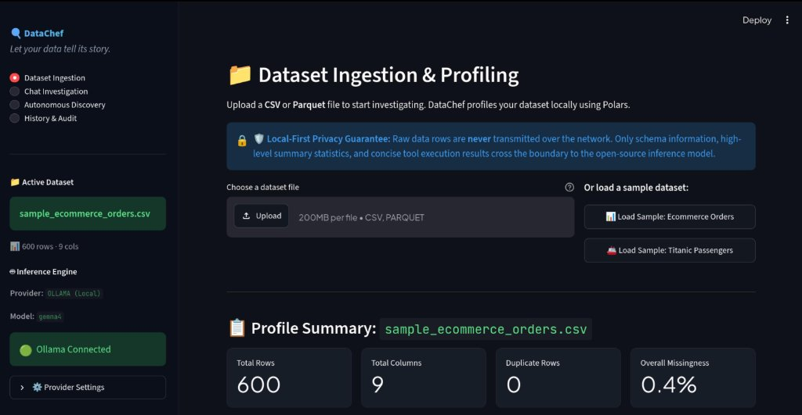
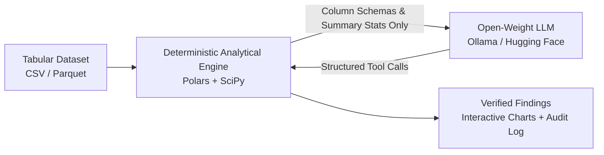

# DataChef

> **Let your data tell its story.**

[](LICENSE)
[](https://www.python.org/downloads/)
[](https://pola.rs/)
[](https://huggingface.co/)
[](https://github.com/astral-sh/ruff)
[](CONTRIBUTING.md)

[Architecture Guide](architecture.md) · [Agent Design & Bounded Loop](agents.md) · [Contributing Guidelines](CONTRIBUTING.md) · [Issue Tracker](https://github.com/ajatshatru01/DataChef/issues)

**DataChef** is an open-source AI agent for autonomous dataset investigation. It pairs open-weight language models with a local, deterministic analytical engine (powered by Polars and SciPy) to explore, audit, and investigate tabular datasets through conversational queries and autonomous discovery.

Unlike standard chatbots that hallucinate numerical facts, DataChef adheres strictly to the principle that **computation is ground truth**: the model reasons, plans, and selects analytical tools, while all calculations and statistics are computed locally on your machine.



---

## Table of Contents

- [Why DataChef?](#why-datachef)
- [Architecture & Privacy Flow](#architecture--privacy-flow)
- [Key Highlights](#key-highlights)
- [Installation from Source](#installation-from-source)
  - [Model Engine Setup](#model-engine-setup)
  - [Linux & macOS](#installation-linux-macos)
  - [Windows](#installation-windows)
  - [Alternative: Using uv](#alternative-using-uv)
- [Configuration](#configuration)
  - [In-App UI Configuration](#in-app-ui-configuration)
  - [Hugging Face Inference Providers](#hugging-face-inference-providers)
  - [Manual Configuration via .env](#manual-configuration-via-env)
- [Running the App](#running-the-app)
  - [Linux & macOS](#running-linux-macos)
  - [Windows](#running-windows)
- [Troubleshooting](#troubleshooting)
- [Contributing](#contributing)
- [License](#license)

---

<a id="why-datachef"></a>
## Why DataChef?

| Capability | Standard AI Chatbots | DataChef |
| :--- | :--- | :--- |
| **Data Privacy** | Raw dataset rows sent across the network | **100% Local-First** — raw data rows never leave your machine |
| **Numerical Accuracy** | Hallucinated statistical estimates | **Deterministic Ground Truth** computed locally via Polars & SciPy |
| **Visualizations** | Text explanations or static snippets | Dark-themed, interactive Plotly charts auto-generated with findings |
| **Auditability** | Ephemeral chat history | Immutable NDJSON audit trail recording every tool call, arg, and result |
| **Exploration Mode** | Requires manual, repetitive user prompting | **Autonomous Discovery** scans 7 deterministic heuristic checks |

---

<a id="architecture--privacy-flow"></a>
## Architecture & Privacy Flow

DataChef strictly separates model reasoning from data execution:



For complete technical specifications, consult the [Architecture Guide](architecture.md) and [Agent Design Document](agents.md).

---

<a id="key-highlights"></a>
## Key Highlights

- **Local-First Privacy Guarantee:** Raw dataset rows are **never** transmitted to the cloud. Only column schemas, summary profile statistics, and concise tool execution results cross the network boundary.
- **Computation as Ground Truth:** Numerical claims are traced to local tool output; unsupported numerical claims are flagged in the finding.
- **Autonomous Discovery Mode:** Scans datasets across 7 deterministic statistical checks without invoking AI models, generates heuristic candidate findings, and deep-dives into high-priority patterns.
- **Interactive Visualizations:** Auto-generates dark-themed Plotly charts (histograms, box plots, group bars, correlation heatmaps, trend lines).
- **Auditable & Reproducible:** Every investigation step, tool call, argument, and result is recorded into immutable NDJSON logs for verification.

<details>
<summary><b>Click to view all 11 deterministic analytical tools</b></summary>

- `get_column_stats`: Descriptive statistics (mean, median, std, min, max, quantiles).
- `compare_groups`: Group-level comparisons with Cohen's $d$ effect sizes and Kruskal–Wallis tests.
- `get_correlation`: Pairwise Pearson & Spearman correlation matrices.
- `detect_outliers`: Tukey IQR fences & Iglewicz–Hoaglin modified Z-scores.
- `analyze_trend`: Temporal monotonicity and period-over-period delta checks.
- `get_value_counts` & `run_cross_tabulation`: Categorical distributions and cross-tabs.
- `get_missing_summary`: Missing value patterns and completeness rates.
- `get_group_distribution` & `get_top_correlations`: Focused grouped and ranked summaries.
- `get_duplicate_summary`: Duplicate counts and bounded row hashes without exposing raw rows.
</details>

---

<a id="installation-from-source"></a>
## Installation from Source

DataChef is installed from source. Python 3.10–3.13 are supported across all platforms.

<a id="model-engine-setup"></a>
### Model Engine Setup (Ollama or Cloud)

To investigate datasets with AI reasoning, DataChef requires an inference engine. By default, it connects to [Ollama](https://ollama.com/) running locally:

1. **Install Ollama:**
   - **Linux:** `curl -fsSL https://ollama.com/install.sh | sh`
   - **macOS:** Download from [ollama.com](https://ollama.com/download) or install via `brew install ollama`
   - **Windows:** Download the installer from [ollama.com](https://ollama.com/download/windows)

2. **Pull the default model & ensure the server is running:**
   ```bash
   ollama pull gemma4
   ollama serve
   ```
   *(On macOS and Linux systemd, Ollama automatically runs as a background service after installation).*

> **Cloud Alternative (No local AI installation required):** If you prefer not to install Ollama locally, you can skip this step and use **Hugging Face** serverless inference instead by pasting a free API token directly in the app's sidebar.

<a id="installation-linux-macos"></a>
### Linux & macOS

**Prerequisites:** Ensure Python 3.10+ is installed (on Debian/Ubuntu: `sudo apt update && sudo apt install python3-venv python3-pip git`; on macOS: via [Homebrew](https://brew.sh/) `brew install python@3.11` or from [python.org](https://www.python.org/downloads/)).

```bash
# Clone the repository
git clone https://github.com/ajatshatru01/DataChef.git
cd DataChef

# Create and activate virtual environment
python3 -m venv .venv
source .venv/bin/activate

# Upgrade pip and install DataChef in editable mode with development tools
pip install --upgrade pip
pip install -e ".[dev]"
```

<a id="installation-windows"></a>
### Windows

**Prerequisites:** Install Python 3.10+ from [python.org](https://www.python.org/downloads/) (check "Add Python to PATH" during installation) or via `winget install Python.Python.3.11`.

**PowerShell:**
```powershell
# Clone the repository
git clone https://github.com/ajatshatru01/DataChef.git
Set-Location DataChef

# Create and activate virtual environment
py -3.11 -m venv .venv
.\.venv\Scripts\Activate.ps1

# Upgrade pip and install DataChef in editable mode with development tools
python -m pip install --upgrade pip
python -m pip install -e ".[dev]"
```

**Command Prompt (cmd.exe):**
```cmd
git clone https://github.com/ajatshatru01/DataChef.git
cd DataChef
py -3.11 -m venv .venv
.\.venv\Scripts\activate.bat
python -m pip install --upgrade pip
python -m pip install -e ".[dev]"
```

> **Note on PowerShell:** If script execution is blocked on Windows, run `Set-ExecutionPolicy -Scope Process Bypass` in your terminal session or run commands directly through `.\.venv\Scripts\python.exe`.

<a id="alternative-using-uv"></a>
### Alternative: Using uv

If you have [uv](https://github.com/astral-sh/uv) installed, you can run DataChef without manual virtual environment management:

```bash
git clone https://github.com/ajatshatru01/DataChef.git
cd DataChef
uv run datachef
```

---

<a id="configuration"></a>
## Configuration

Once Ollama is running in the background (or a Hugging Face token is provided), DataChef requires **no configuration files to edit**:
- On first launch, DataChef automatically creates `.env` from `.env.example` pre-configured for local Ollama (`http://localhost:11434`, model `gemma4`).
- You can switch providers or update model names at any time directly in the web UI.

<a id="in-app-ui-configuration"></a>
### In-App UI Configuration

You can configure and switch model providers directly within the running application:
1. Launch DataChef and navigate to the sidebar.
2. Expand the **Provider Settings** section under **Inference Engine**.
3. Choose your provider (**Ollama** or **Hugging Face**).
4. Enter your Hugging Face API key or customize your Ollama host and model name.
5. Click **Apply Settings** to update the session immediately without restarting.

<a id="hugging-face-inference-providers"></a>
### Hugging Face Inference Providers

Run inference using hosted models through Hugging Face's serverless inference infrastructure.

1. Create a Hugging Face token with **Inference Providers** permission at [huggingface.co/settings/tokens](https://huggingface.co/settings/tokens).
2. Enter your token directly in the application's sidebar under **Provider Settings**, or set it in `.env`.

<a id="manual-configuration-via-env"></a>
### Manual Configuration via .env

<details>
<summary><b>Click to inspect manual .env file setup and options</b></summary>

If you prefer configuring via files or environment variables, `.env` is created automatically on first run, or you can copy it manually:

**Linux & macOS:**
```bash
cp .env.example .env
```

**Windows (PowerShell):**
```powershell
Copy-Item .env.example .env
```

**Example `.env` settings:**

For Ollama:
```env
DATACHEF_PROVIDER=ollama
OLLAMA_HOST=http://localhost:11434
OLLAMA_MODEL=gemma4
```

For Hugging Face:
```env
DATACHEF_PROVIDER=huggingface
HF_API_KEY=hf_your_token_here
HF_MODEL_ID=Qwen/Qwen2.5-72B-Instruct
HF_INFERENCE_PROVIDER=auto
```
</details>

---

<a id="running-the-app"></a>
## Running the App

Ensure your virtual environment is activated before launching the app.

<a id="running-linux-macos"></a>
### Linux & macOS

```bash
# Option 1: Console entry point
datachef

# Option 2: Streamlit CLI directly
streamlit run datachef/ui/app.py

# Option 3: Python module syntax
python3 -m streamlit run datachef/ui/app.py
```

<a id="running-windows"></a>
### Windows

**PowerShell:**
```powershell
# Option 1: Console entry point
datachef

# Option 2: Python module syntax
python -m streamlit run datachef/ui/app.py
```

**Command Prompt (cmd.exe):**
```cmd
datachef
REM or
python -m streamlit run datachef/ui/app.py
```

Open your browser at `http://localhost:8501`.

> **Quick Exploration Tip:** Don't have a dataset ready? Use the built-in benchmark buttons (**"Load Sample: Ecommerce Orders"** or **"Load Sample: Titanic Passengers"**) on the Dataset Ingestion page to test profiling and autonomous discovery immediately with zero setup.

---

<a id="troubleshooting"></a>
## Troubleshooting

- **Ollama connection warning:** Ensure Ollama is running (`ollama serve` or system service) and that `OLLAMA_MODEL` matches the name in `ollama list`.
- **Hugging Face error:** Verify `HF_API_KEY`, model availability, and that the selected provider supports chat completions with tool calling.
- **No useful tool calls:** Use a tool-capable model; very small local models may produce conversational text instead of structured function calls.
- **Port 8501 already in use:** Specify a different port:
  - Linux/macOS: `python3 -m streamlit run datachef/ui/app.py --server.port 8502`
  - Windows: `python -m streamlit run datachef/ui/app.py --server.port 8502`
- **PowerShell script execution disabled (Windows):** Run `Set-ExecutionPolicy -Scope Process Bypass` in that terminal session.
- **Environment reset:** If configuration problems persist, delete `.env`, copy `.env.example` again, and restart Streamlit.

---

<a id="contributing"></a>
## Contributing

Contributions are welcome! DataChef follows an **issue-first contribution workflow**:
1. Open an issue describing your proposed feature, bug fix, or improvement.
2. Confirm scope with maintainers before implementing.
3. Submit a focused pull request linked to the issue.

For full guidelines on local verification, coding standards, and architectural boundaries, see the [Contributing Guide](CONTRIBUTING.md).

---

<a id="license"></a>
## License

This project is licensed under the [MIT License](LICENSE).
